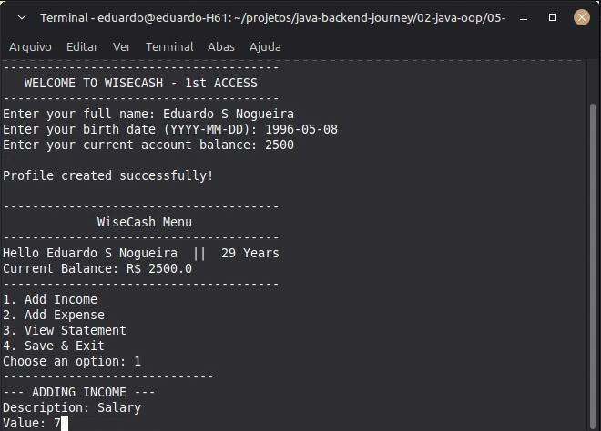

# WiseCash — controle financeiro no terminal

**Status: pausado em outubro de 2026.** O projeto permanece como registro de aprendizagem. O foco atual é retomar os fundamentos de Java e o curso da Udemy.

Aplicação de estudo em Java para controle financeiro pessoal no terminal, com persistência em arquivos CSV.

## Estrutura do código

- Entidades User e Transaction.
- Categorias e tipos de transação representados por enums.
- Controllers para interação com a aplicação.
- Interfaces DAO e implementações para arquivos CSV.
- Serviços de extrato e relatório financeiro.
- Testes JUnit para entidades e serviços.

## Tecnologias presentes

Java, Maven, CSV, BigDecimal, LocalDate e JUnit. Consulte o pom.xml para a configuração do projeto.

## Escopo documentado

O projeto contém código para cadastro de perfil, receitas, despesas, extrato e persistência CSV. Esta atualização de documentação não representa uma nova validação da execução ou dos testes.

## Ideias futuras — fora do escopo atual

Os itens abaixo eram propostas de evolução e não são apresentados como funcionalidades entregues nesta versão:

- API REST com Spring Boot.
- Banco de dados PostgreSQL.
- Autenticação JWT.
- Exportação de relatórios em PDF.

## Demonstração

## Autor

[Eduardo Nogueira](https://www.linkedin.com/in/eduardosnogueira/) — estudante de Engenharia de Software no IESB.
